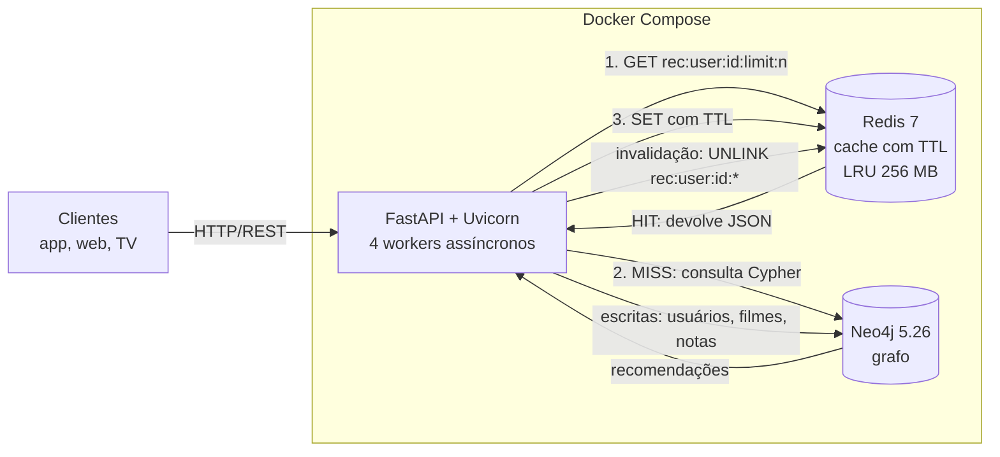
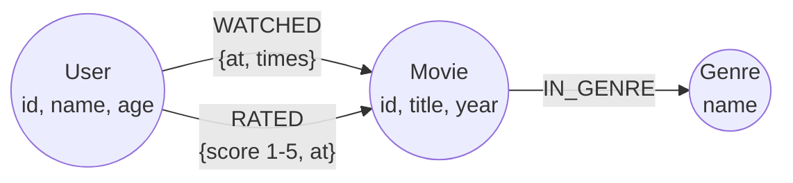
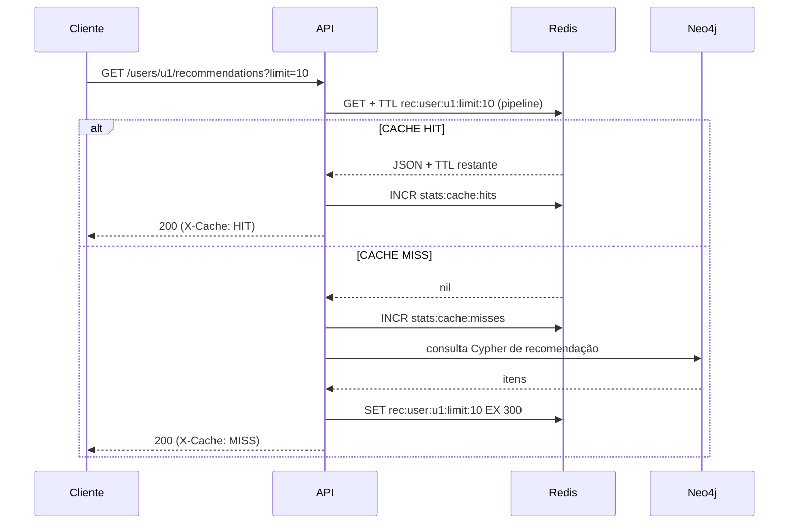

# Arquitetura da solução

## 1. Visão geral



| Componente | Responsabilidade | Decisões |
|---|---|---|
| **FastAPI** | Expõe a API REST, valida entradas (Pydantic) e gera o Swagger | Endpoints `async`; 4 workers Uvicorn atendem vários usuários simultaneamente |
| **Neo4j** | Fonte da verdade: usuários, filmes, gêneros e interações | Driver oficial assíncrono com pool de 50 conexões; constraints de unicidade |
| **Redis** | Cache das recomendações e contadores de métricas | Padrão *cache-aside*, TTL, `maxmemory-policy allkeys-lru` |

A aplicação é **stateless**: todo o estado fica no Neo4j e no Redis. Por isso ela escala horizontalmente com mais workers ou réplicas atrás de um balanceador, e todas as réplicas compartilham o mesmo cache e as mesmas métricas.

## 2. Modelo de dados em grafo



- **Constraints:** `User.id`, `Movie.id` e `Genre.name` são únicos. Isso também cria índices e deixa rápidos os `MATCH` por id.
- **Avaliar implica assistir:** ao registrar uma nota, a API também cria a relação `WATCHED`.
- **Por que um grafo?** Perguntas como "quem gostou do que eu gostei e o que mais essas pessoas gostaram" viram travessias de 2 a 3 saltos. Em um banco relacional, elas exigiriam vários JOINs sobre tabelas grandes.

## 3. Algoritmo de recomendação (híbrido)

Implementado em **uma única consulta Cypher** ([app/services/recommendation.py](../app/services/recommendation.py)). Ela une dois sinais com `CALL { ... UNION ALL ... }`:

**a) Filtragem colaborativa ("usuários similares")**
1. Encontra usuários que deram nota ≥ 4 aos mesmos filmes que o usuário alvo avaliou com nota ≥ 4.
2. `similaridade` = número de filmes em comum que ambos gostaram; usa os 25 vizinhos mais similares.
3. Candidatos: filmes que esses vizinhos avaliaram com nota ≥ 4 e o alvo **não assistiu**.
4. `score_colab = Σ (similaridade × nota do vizinho)`.

**b) Baseada em conteúdo ("gênero favorito")**
1. Afinidade com cada gênero = soma, sobre os filmes assistidos do gênero, de `nota − 2,5` (ou `1` quando o filme foi só assistido, sem nota). Notas baixas reduzem a afinidade.
2. Candidatos: filmes dos gêneros com afinidade positiva ainda não assistidos.
3. `score_genero = Σ afinidade × 2`.

**c) Score final**
```
score = score_colab + score_genero + 5 × nota_média_global_do_filme
```
Cada item informa em `reasons` qual sinal o recomendou, o que dá explicabilidade.

**Cold start:** se o usuário não tem histórico, a API devolve os filmes **populares** que ele não viu (`nota_média × log10(votos + 1)`, com no mínimo 3 votos) e `strategy = "popular"`.

## 4. Estratégia de cache

### 4.1 Cache-aside



| Aspecto | Implementação |
|---|---|
| **Chave** | `rec:user:{user_id}:limit:{limit}`. O prefixo por usuário permite invalidar por padrão |
| **Valor** | JSON com `strategy`, `generated_at` e `items` |
| **TTL** | `CACHE_TTL_SECONDS` (padrão 300 s). O TTL restante é devolvido no corpo e no header `X-Cache-TTL` |
| **HIT/MISS** | Campo `cache` na resposta, header `X-Cache`, linha de log `CACHE HIT` ou `CACHE MISS` e contadores em `GET /cache/stats` |
| **Bypass** | `?use_cache=false` ignora o Redis (`cache: BYPASS`). Usado para comparar desempenho |
| **Memória** | `maxmemory 256mb` + `allkeys-lru`: se a memória encher, o Redis descarta as chaves menos usadas |
| **Métricas** | `stats:cache:hits`, `stats:cache:misses`, `stats:neo4j:queries` e `stats:cache:invalidations`, compartilhadas entre os workers |

### 4.2 Invalidação

| Evento | O que é invalidado | Motivo |
|---|---|---|
| `POST /users/{id}/ratings` | `rec:user:{id}:*` | O histórico do usuário mudou; a recomendação dele fica obsoleta na hora |
| `POST /users/{id}/watched` | `rec:user:{id}:*` | O filme assistido não pode continuar sendo recomendado |
| `POST /movies` e `POST /movies/{id}/genres` | `rec:*` | O catálogo mudou; o filme novo pode interessar a qualquer usuário |
| `DELETE /cache/users/{id}` | `rec:user:{id}:*` | Invalidação manual ou administrativa |
| `DELETE /cache` | `rec:*` | Invalidação total (ex.: após a carga de dados) |
| Expiração do TTL | a chave | Garante que mudanças **indiretas** apareçam em até 5 min (ex.: uma nota do usuário B altera a recomendação colaborativa do usuário A) |

A invalidação usa `SCAN` + `UNLINK` em lotes, e não `KEYS` + `DEL`. Assim o Redis não bloqueia, mesmo com milhões de chaves.

### 4.3 Por que invalidação + TTL?

- A invalidação **explícita** garante consistência imediata para o próprio usuário: quem acabou de avaliar um filme não o vê de novo como recomendação.
- O **TTL** limita o tempo de dados obsoletos nas mudanças indiretas, que seriam caras de rastrear. Invalidar todos os vizinhos de um usuário a cada nota custaria mais do que recalcular.
- É o equilíbrio usual em sistemas de recomendação: recomendações com alguns minutos de atraso são aceitáveis, enquanto consultas pesadas a cada acesso não são.

## 5. Concorrência

- **Uvicorn com 4 workers** (processos) e endpoints `async`: enquanto uma requisição espera o Neo4j, o mesmo worker atende outras.
- **Pool de conexões** do Neo4j (50 por worker) e do Redis (200 por worker), reaproveitadas entre requisições.
- **Pipeline no Redis:** `GET` e `TTL` vão em uma única ida à rede.
- **Neo4j** configurado com 1 GB de heap e 512 MB de page cache, o que basta para o grafo inteiro ficar em memória.

## 6. Limitações e evolução

| Limitação | Evolução proposta |
|---|---|
| *Cache stampede*: vários MISS simultâneos para o mesmo usuário recalculam a mesma recomendação (observado no benchmark: 206 MISS para 200 usuários) | Lock distribuído (`SET NX`) ou *single-flight* por chave |
| O MISS ainda custa centenas de ms sob carga | Pré-computar recomendações em lote (job noturno com `CALL ... IN TRANSACTIONS`) ou usar Neo4j GDS (Node Similarity) |
| Invalidação por padrão usa SCAN | Manter um SET com as chaves de cada usuário, ou usar versionamento de chave (`rec:v{n}:...`) |
| Instância única de Neo4j e Redis | Neo4j Cluster (réplicas de leitura) e Redis Sentinel/Cluster |
| Sem autenticação | OAuth2/JWT no FastAPI e rate limiting |
