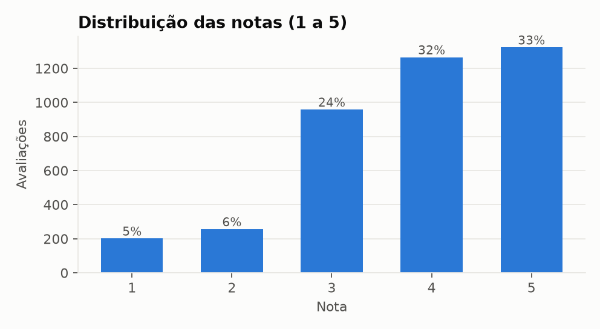
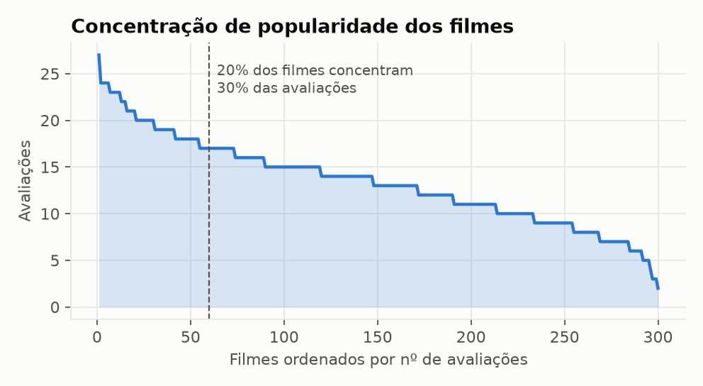
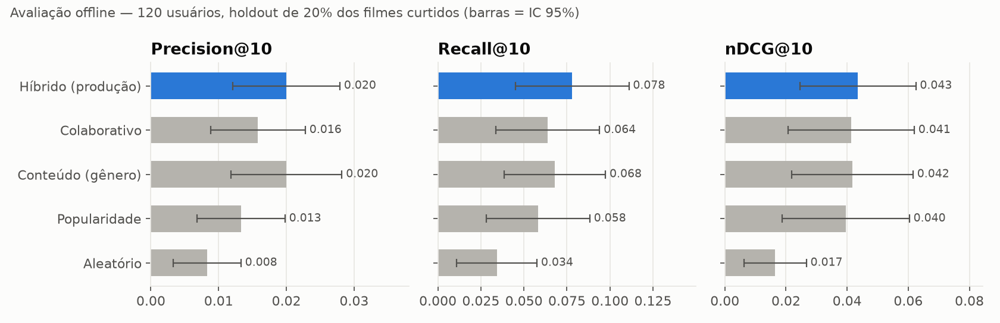
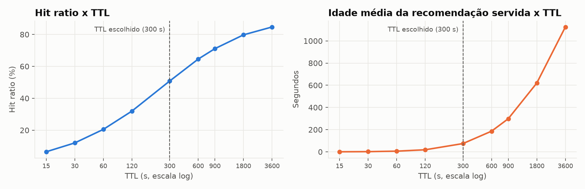
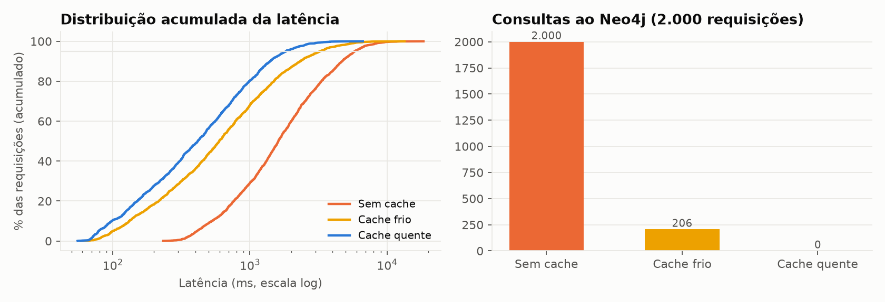

# Relatório de análise de dados — StreamRec

Gerado em 2026-09-28 16:53:22 por `scripts/analise_dados.py`.

## 1. Análise exploratória

- 200 usuários, 300 filmes, 12 gêneros
- 5736 relações WATCHED e 4003 RATED (taxa de avaliação 70%)
- Matriz usuário x filme: densidade 6.67%, esparsidade 93.33%
- Nota média 3.813 (desvio 1.115)
- 20% dos filmes concentram 30% das avaliações

## 2. Avaliação offline (K=10, 120 usuários, holdout 20%)

| Modelo | Precision@10 | Recall@10 | nDCG@10 | HitRate@10 | Cobertura | Viés pop. | Latência (ms) |
|---|---:|---:|---:|---:|---:|---:|---:|
| Híbrido (produção) | 0.020 ± 0.008 | 0.078 | 0.043 | 0.18 | 62% | 1.27x | 75.6 |
| Colaborativo | 0.016 ± 0.007 | 0.064 | 0.041 | 0.15 | 70% | 1.27x | 44.1 |
| Conteúdo (gênero) | 0.020 ± 0.008 | 0.068 | 0.042 | 0.17 | 59% | 1.2x | 57.6 |
| Popularidade | 0.013 ± 0.006 | 0.058 | 0.040 | 0.12 | 5% | 1.57x | 156.5 |
| Aleatório | 0.008 ± 0.005 | 0.034 | 0.017 | 0.08 | 98% | 0.97x | 0.1 |

## 3. Simulação de TTL

| TTL (s) | Hit ratio | Consultas Neo4j/h | Idade média (s) |
|---:|---:|---:|---:|
| 0 | 0.0% | 2024 | 0.0 |
| 15 | 6.5% | 1892 | 0.5 |
| 30 | 12.0% | 1780 | 1.8 |
| 60 | 20.5% | 1608 | 6.2 |
| 120 | 32.0% | 1377 | 18.6 |
| 300 | 50.8% | 996 | 74.6 |
| 600 | 64.6% | 717 | 186.1 |
| 900 | 71.1% | 585 | 298.2 |
| 1800 | 79.7% | 410 | 619.9 |
| 3600 | 84.7% | 310 | 1125.2 |

## 4. Testes de carga

| Cenário | req/s | Média | Desvio | p50 | p95 | p99 | CV | Consultas Neo4j |
|---|---:|---:|---:|---:|---:|---:|---:|---:|
| sem_cache | 22.3 | 2187.2 | 1820.4 | 1612.8 | 5823.3 | 8369.1 | 0.83 | 2000 |
| cache_frio | 49.0 | 988.2 | 1148.8 | 598.6 | 3247.4 | 5579.5 | 1.16 | 206 |
| cache_quente | 77.5 | 623.3 | 624.3 | 416.7 | 1834.7 | 2985.2 | 1.0 | 0 |

